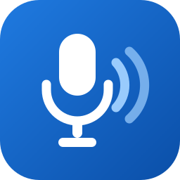
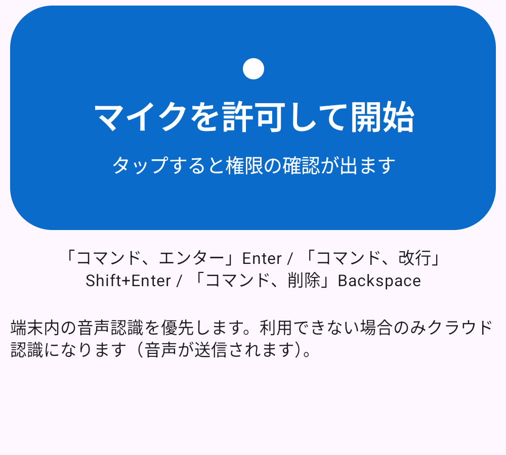

# instant-mic



Android スマホを、同じ LAN の Windows PC の「音声入力キーボード」にするアプリ。

[](https://github.com/tonbiattack/instant-mic/actions/workflows/ci.yml)
[](https://github.com/tonbiattack/instant-mic/releases)
[](LICENSE)
[](#ダウンロード)
[](android)
[](go.mod)

スマホに向かって話すと、PC の入力欄にそのまま文字が入ります。音声は認識サービス以外へ送らず、PC 側では認証済みの操作だけを受け付けます。

<p align="center">
  
</p>

## 特長

- **ワンタップで話せる** — 起動即録音、止めるまで連続入力
- **QR を読むだけでペアリング** — 以後は同じ PC に自動接続
- **PC 側で直接入力** — `SendInput`（Unicode）を使い、クリップボードを汚さない
- **コマンドは二重に検証** — スマホと PC の両方で解釈し、片方が壊れても誤爆しない
- **取り消しは文字数が一致したときだけ** — 推測で消さない
- **誤変換対策** — 開発用語辞書、ひらがな入力、無音判定の調整
- **危険な操作は確認** — 送信・削除の前にワンタップ

## 動作環境

| | 要件 |
| --- | --- |
| スマホ | Android 8.0 (API 26) 以上 |
| PC | Windows 10 / 11 (x64) |
| ネットワーク | 同じ LAN（インターネット不要） |

## インストール

[Releases](https://github.com/tonbiattack/instant-mic/releases) から最新版を取得してください。

| 配布物 | 対象 | 内容 |
| --- | --- | --- |
| `instant-mic-windows-amd64.zip` | Windows 10/11 (x64) | 受信アプリ（exe）と手順書 |
| `instant-mic-android.apk` | Android 8.0 以上 | 送信アプリ |

各ファイルの `.sha256` も一緒に公開しています。取得後に照合できます。

```powershell
# Windows
Get-FileHash .\instant-mic-windows-amd64.zip -Algorithm SHA256
# Android（PC 上で）
certutil -hashfile instant-mic-android.apk SHA256
```

### Windows への導入

1. ZIP を展開する
2. `instant-mic.exe` を右クリック → プロパティ →「ブロックの解除」にチェック（初回のみ）
3. `instant-mic.exe` を実行する
4. 接続できない場合は、Windows ファイアウォールで `instant-mic.exe` の受信を許可する

設定は `%AppData%\instant-mic\config.json` に保存されます。終了は通知領域のアイコンから「終了」を選びます。

### Android への導入

1. `instant-mic-android.apk` を端末へ移して開く
2. 「提供元不明のアプリ」のインストールを求められたら、そのアプリ（ブラウザやファイルマネージャ）に許可を与える
3. インストールして起動する

**必ずこのリポジトリの Releases から取得してください。** APK は改変されていないかを SHA-256 で確認できます。他の配布元の APK は、同じ署名でない限り上書きインストールできません（逆に言うと、一度別の配布元のものを入れると、公式版を入れる前にアンインストールが必要になります）。

### ペアリング

1. Windows の通知領域のアイコンを右クリック →「ペアリングを開始」（QR と6桁コードが出る）
2. Android アプリで「QRコードを読み取る」を押して読み取る
3. 以後はアプリを開くだけで自動接続します

QR を読み取れない場合は、PC 画面の6桁コードと IP アドレスを手動で入力できます。

## 使い方

1. PC の入力したい欄（メモ帳、ブラウザ、エディタなど）をクリックしてフォーカスする
2. Android アプリで「タップして話す」を押して話す
3. 話し終えると確定したテキストが PC に入力される
4. 「コマンド、送信」で Enter、「コマンド、改行」で Shift+Enter、「コマンド、言い直し」で直前の入力を取り消す

連続音声入力では、無音を挟んで話し続けてもそのまま次の発話が入力されます。止めるときだけもう一度タップします。

### 句読点・記号を話して入力する

文章の中で記号の名前を話すと、通常のテキストとして入力できます。

| 話す言葉 | 入力される記号 |
| --- | --- |
| まる | 。 |
| てん | 、 |
| はてな | ？（全角） |
| びっくりまーく | ！ |
| ころん | ： |
| せみころん | ； |
| すらっしゅ | / |
| かっこ 〜 かっことじ | （ 〜 ） |
| かぎかっこ 〜 かぎかっことじ | 「 〜 」 |

例: 「これで合ってる はてな」→「これで合ってる？」。単独の記号は文末や区切りの位置で変換され、かっこは開きと閉じがそろっているときに変換されます。認識結果によっては変換されない場合があります。


仕様: [docs/spec.md](docs/spec.md) / プロトコル: [docs/protocol.md](docs/protocol.md) / 機能提案と採否: [docs/proposals.md](docs/proposals.md) / 設計の評価と比較: [docs/evaluation.md](docs/evaluation.md)

## 構成

```
cmd/instant-mic/        Windows 受信アプリ（Go）
internal/speech/        コマンド解釈（Go 側。Android と同一ルール）
internal/server/        WebSocket・ペアリング・重複防止
internal/input/         SendInput による文字/キー入力（Windows）
internal/config/        ペアリング情報と設定の保存
android/                Android アプリ（Kotlin + Compose）
```

## Windows 受信アプリ

```powershell
go build -o instant-mic.exe ./cmd/instant-mic
.\instant-mic.exe
```

起動すると待ち受け先と証明書の指紋が表示される。

```
instant-mic receiver
  サーバー名 : MyPC
  待ち受け   : [::]:8765
  暗号化     : TLS (自己署名証明書)
  証明書指紋 : 9f13…（64桁）
  接続先候補 :
    wss://192.168.1.20:8765
```

| 操作 | 内容 |
| --- | --- |
| `p` | ペアリング開始（6桁コードを10分間表示） |
| `c` | ペアリング中止 |
| `d` | ペアリング済み端末の一覧 |
| `q` | 終了 |

主なオプション: `-addr :8765`、`-pair`（起動と同時にペアリング開始）、`-devices`、`-unpair <id|name>`、`-command-prefix <語>`、`-no-tls`（デバッグ専用）、`-tray`（トレイ常駐）、`-autostart on|off|status`（ログイン時自動起動）、`-no-discovery`（mDNS無効）。

`-tray` で起動すると通知領域だけに常駐し、右クリックメニューからペアリングQRの表示・中止・終了ができる。ログイン時の自動起動を有効にすると、次回からこのモードで起動する。

設定は `%AppData%\instant-mic\config.json` に保存される。トークンは SHA-256 ハッシュのみ保存し、平文では残さない。

## Android アプリ

```powershell
cd android
.\gradlew.bat assembleDebug
adb install -r app\build\outputs\apk\debug\app-debug.apk
```

1. PC で受信アプリを起動し `p` を押す
2. スマホのアプリで「QRコードを読み取る」を押し、PC画面のQRをスキャン（読めない場合のみ手動入力）
   - Google 純正のスキャナが起動する（Play 開発者サービス非搭載端末はアプリ内蔵スキャナ）
   - 普段使っているQRアプリ・カメラで読み取っても、本アプリが開いてペアリングできる
3. 「タップして話す」を押して発話 → 確定後に PC の入力欄へ反映
4. 連続音声入力では、無音を挟んで続けて話してもそのまま次の発話が入力される（止めるときだけタップ）
5. 2回目以降はアプリを開くだけで、同じPCへ自動接続する

上部の「コマンド」から、連続音声入力・振動の有無・起動時の自動開始・カスタムコマンドを設定できる。

### 認識精度の設定

同じ発話でも方式によって誤変換の数と応答時間が変わるので、比べてから選ぶ。

| 設定 | 選択肢 |
| --- | --- |
| 認識方式 | 端末内を優先（既定・通信不要） / システム既定（ネットワーク利用可） |
| 話し終わりの待ち時間 | 短め 800ms / 標準 1,200ms（既定） / 長め 2,000ms |
| 開発用語の辞書 | 有効（既定） / 無効 |
| ひらがなで入力する | 有効 / 無効（既定） |
| 送信・削除の前に確認する | 有効 / 無効（既定） |
| 入力の反映 | 確定してから入力（既定） / 区切りごとに早めに入力 |

- 辞書は `ギットハブ`→`GitHub`、`コーデックス`→`Codex` などを直す。URL・コード・数字・ASCII は変更しない
- **ひらがなで入力する**をオンにすると、漢字に変換せず読みのまま入力する。`改行`/`開業` のような漢字選択ミスが原理的に消えるので、AI への指示書きに向く。英数字・URL・記号は残る
  - 例: 今日は会議があります → きょうはかいぎがあります
  - 辞書で `GitHub` に直した語も読みになる（ぎっとはぶ）。コードとして貼りたい場合はオフにする
- 認識候補が複数返る場合は画面に並ぶ。**自動では切り替えない**（選んでもPCへ追加入力はしない）
- **送信・削除の前に確認する**をオンにすると、「コマンド、送信」「削除」などを実行する前に確認ボタンが出る。AI チャットへの誤送信を防ぎたいときに使う（既定はオフ）
- 接続カードに **入力先**（PC 側でフォーカス中のウィンドウ）を表示する。フォーカスがない・管理者権限で入力できない場合は赤字で示す
- 「区切りごとに早めに入力」は文末で区切れた部分を先にPCへ送る。認識結果が後から変わった場合は追加入力せず、確認を表示する
- 端末や認識サービスによってはヒント（無音判定・オフライン優先・語彙）が無視される。画面の表示は実際の認識状態を示す

### 比べて選ぶ手順

1. 認識方式を「端末内を優先」にして、GitHub・Codex・SQL・Go・Nuxt を含む同じ文を3回読む
2. 誤変換の数と、話し終えてからPCに入力されるまでの時間をメモする
3. 「システム既定」に切り替えて同じ文を読む
4. 誤変換が少ない方（通信を避けたい場合は端末内）を選ぶ

辞書の修正だけでは直らない誤りが多い場合は、無音判定を「長め」にして発話の分断を減らす。

### すぐ話す

- Quick Settings（通知シェードのタイル）に「音声入力」を追加すると、タイルをタップするだけでアプリが開いて聞き取りが始まる
- 設定の「起動したらすぐ話す」をオンにすると、アプリを開いた時点で聞き取りが始まる
- どちらも画面を離れると停止する（バックグラウンドでは録音しない）

### 音声認識のプライバシー

Android 13 以降で端末内認識が利用できる場合はオフライン認識を優先する。利用できない端末では Google などのクラウド認識になり、音声が送信される。アプリは音声を保存しない（録音ファイルも履歴も持たない）。

## 動作の要点

- **確定結果のみ送信**: 認識途中の partial result は破棄するので二重確定しない
- **連続音声入力**: 状態（準備中／聞き取り中／処理中／再開待ち）を実際の `SpeechRecognizer` と一致させ、無音で終わっても自動再開する。停止後は再開しない
- **ACK ベース**: PC からの ACK が返るまで「送信しました」と表示しない
- **重複実行防止**: 各操作に一意な ID を付け、PC 側で実行済み ID を記憶する。認識セッション ID でも二重通知を防ぐ
- **コマンドの完全一致**: 接頭語 + 区切り + コマンド語のみ実行。文中の「送信」では発火しない。PC 側でも再解釈する
- **キーの許可リスト**: 送信側・受信側の両方でキー列を検証し、PC 側は許可されたキーだけを `SendInput` に渡す
- **自動再接続**: 保存したサーバーIDとTLS指紋が一致するPCにだけ自動接続する。別PCや証明書変更時は再ペアリングを促す
- **言い直し**: 直前のテキスト入力を `erase` メッセージで取り消す。受信側の記録と件数が一致したときだけ実行し、二重削除を防ぐ
- **句読点整形**: 通常テキストだけに適用し、コマンド判定を壊さない。単語の一部になる「まる」「てん」は変換しない
- **フォーカス/権限**: 入力先がない、または管理者権限のウィンドウの場合は安全に失敗し、スマホに理由を返す（UAC 回避はしない）
- **認証**: 未ペアリング端末は WebSocket も `/pair` も通さない。ブラウザからの接続（Origin 付き）は拒否する

## 制限

- 同一 LAN 専用。インターネット越しの接続は対象外
- mDNS が使えないネットワークでは自動検出が働かない（保存済みアドレスで接続、または手動入力に切り替え）
- Android のバックグラウンドでの常時マイク待機は対象外（画面を開いて使う。`onPause` で停止する）
- 管理者権限で動作するアプリや一部ゲームには入力できない
- Enter の意味はアプリごとに異なる（送信/改行）。カスタムコマンドで置き換えられる

## ライセンス

[MIT License](LICENSE)。商用・改変・再配布は自由ですが、著作権表示と本許諾文を残してください。無保証です。

同梱ライブラリの表示は [THIRD_PARTY_NOTICES.md](THIRD_PARTY_NOTICES.md) にまとめています。特に Kuromoji の IPADIC 辞書は Apache-2.0 と NAIST/ICOT の条項により **NOTICE の保持が必須**なので、配布物（APK 内の assets、Windows ZIP 内）にも同じファイルを含めています。

## 開発

```powershell
go test ./...
go vet ./...
cd android && .\gradlew.bat testDebugUnitTest lintDebug assembleDebug
```

`testDebugUnitTest` には Compose の UI テストも含まれる（Robolectric で JVM 上で動くため、実機もエミュレータも不要）。確認ダイアログ・修正警告・送信結果の表示は CI で検証される。マイク・認識サービス・`SendInput` の実挙動だけは実機で確認する。

`scripts/e2e-target.ps1` は SendInput の手動確認用に、入力内容を記録するテキストボックスを開く。`cmd/e2eclient` はペアリング→送信を CLI で再現する補助ツール（`-qr "<ペイロード>"` でQRペアリング、`-literal` で途中フレーズ、`-discover` でLAN内の受信アプリ一覧）。`cmd/tryinput` は指定したキー列をカレントのフォーカス先へ送る確認用（`-expect-title` で誤入力を防止）。
